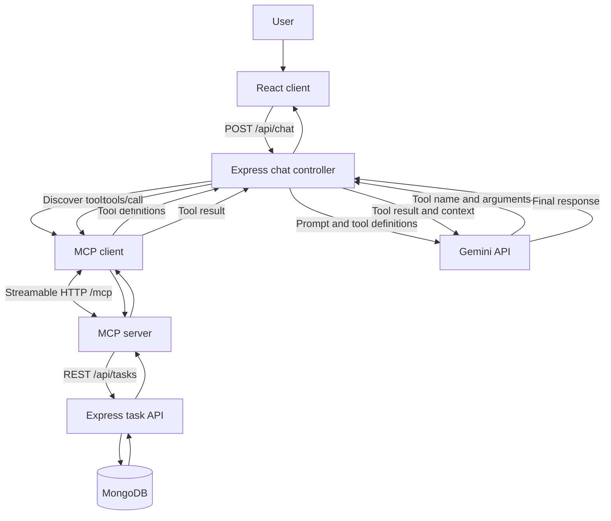

# TaskMate AI

A MERN task manager with a React chat interface. Gemini can use MCP tools to read and manage tasks through the app's REST API.

## Architecture



Gemini chooses whether to call a task tool. The chat controller invokes that tool through MCP; the MCP server forwards it to the task REST API, which reads or updates MongoDB. The result is returned to Gemini to form the chat response.

## Requirements

- Node.js 22 or later
- A MongoDB connection string (local or hosted)
- A Gemini API key with access to a model that supports `generateContent` and function calling

## Install

Install dependencies in each app directory:

```sh
cd server
npm install

cd ../mcp-server
npm install

cd ../client
npm install
```

## Configure environment

Create `server/.env`:

```env
MONGO_URI=mongodb://127.0.0.1:27017/task-manager
GEMINI_API_KEY=your-gemini-api-key
GEMINI_MODEL=gemini-3.5-flash-lite
PORT=5000
MCP_SERVER_URL=http://127.0.0.1:5001/mcp
```

Create `mcp-server/.env`:

```env
PORT=5001
API_BASE_URL=http://127.0.0.1:5000
```

Optionally create `client/.env` to override the task API URL:

```env
VITE_API_BASE_URL=http://127.0.0.1:5000
```

Use a Gemini model ID available to your API key. Keep API keys in local `.env` files; they are ignored by Git and should never be committed.

## Run locally

Start each service in a separate terminal, from its directory:

```sh
# Terminal 1: REST API and chat controller
cd server
npm run dev
```

```sh
# Terminal 2: MCP server
cd mcp-server
npm run dev
```

```sh
# Terminal 3: React client
cd client
npm run dev
```

Open the Vite URL printed in the client terminal (typically `http://localhost:5173`).

## MCP tools

The MCP server exposes these tools:

| Tool | Purpose |
| --- | --- |
| `get_all_tasks` | Retrieve all tasks |
| `create_task` | Create a task |
| `get_task_by_id` | Retrieve a task by MongoDB ID |
| `update_task` | Update a task |
| `delete_task` | Delete a task |

The MCP endpoint is `http://127.0.0.1:5001/mcp`. The task API is available at `http://127.0.0.1:5000/api/tasks`.

## Client checks

Run these commands from `client`:

```sh
npm run lint
npm run build
```
